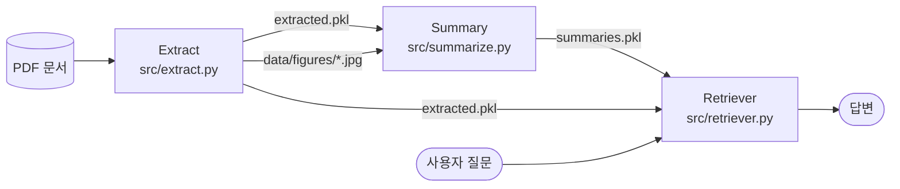
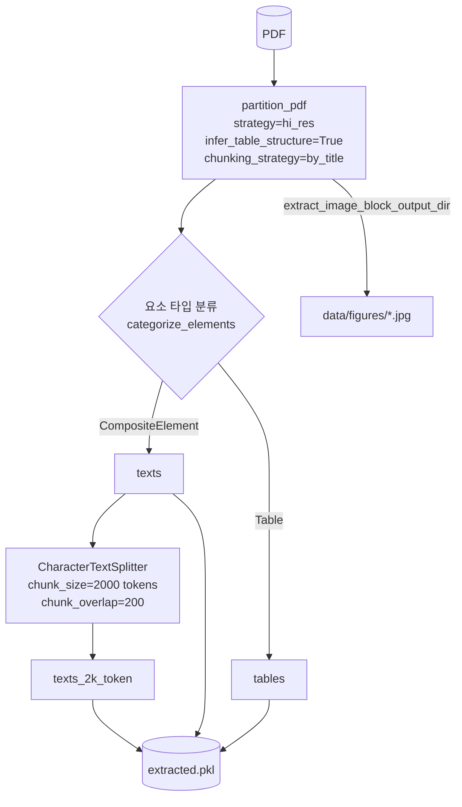
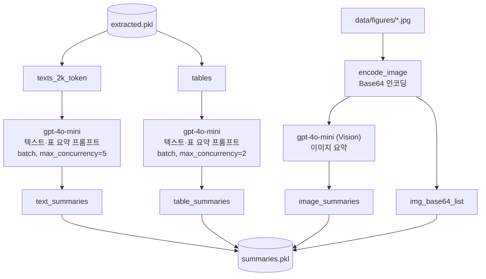
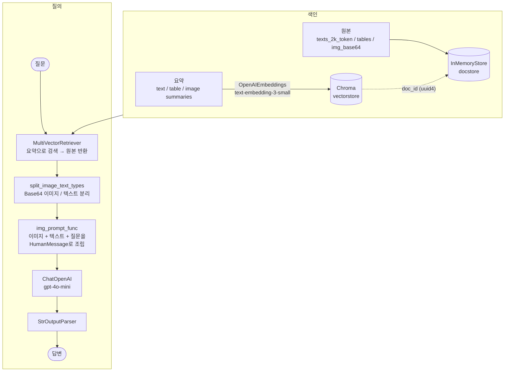
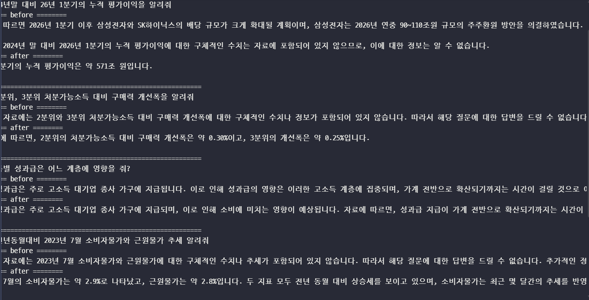

# Multimodal RAG

PDF 문서의 **텍스트 · 표 · 이미지**를 함께 검색하고, 멀티모달 LLM으로 답변을 생성하는 RAG 파이프라인입니다.

---

## 1. 문제 정의

일반적인 RAG 시스템은 문서를 **텍스트로만** 변환해 임베딩하고 검색합니다.
그런데 PDF 문서의 상당한 정보는 텍스트가 아닌 형태로 들어 있습니다.

- **표**: 행·열 구조가 깨진 채 문자열로 뽑히면 값과 항목의 대응 관계가 사라집니다.
- **그래프·도표·이미지**: 텍스트 추출 과정에서 통째로 누락됩니다. 추세, 수치, 비교처럼 그림으로만 표현된 정보는 검색 대상에서 빠집니다.

결과적으로 텍스트 전용 RAG는 "그래프에서 2026년 1분기 값은?"처럼 **표나 그림을 봐야만 답할 수 있는 질문**에 답하지 못합니다. 검색할 데이터 자체가 없기 때문입니다.

이 프로젝트는 PDF를 텍스트 / 표 / 이미지로 분리해 추출하고, 각각을 검색 가능한 요약으로 만든 뒤, 검색 시에는 **원본(텍스트·표·이미지)** 을 멀티모달 LLM에 전달하는 방식으로 이 정보 손실을 줄이는 것을 목표로 합니다.

---

## 2. 아키텍처

### 2-1. 전체 구조



| 단계 | 파일 | 입력 | 출력 |
| --- | --- | --- | --- |
| Extract | `src/extract.py` | `data/*.pdf` | `data/processed/extracted.pkl`, `data/figures/*.jpg` |
| Summary | `src/summarize.py` | `extracted.pkl`, `data/figures/` | `data/processed/summaries.pkl` |
| Retriever | `src/retriever.py` | `extracted.pkl`, `summaries.pkl`, 질문 | 답변 |

### 2-2. Extract — PDF 요소 추출 및 분할



- `unstructured`의 `partition_pdf`(`hi_res` 전략)로 레이아웃을 분석해 텍스트 블록, 표, 이미지를 추출합니다.
- 텍스트는 `tiktoken` 기준 2,000 토큰 단위(200 토큰 중첩)로 다시 분할합니다.

### 2-3. Summary — 검색용 요약 생성



- 텍스트·표·이미지를 각각 **검색에 최적화된 한국어 요약**으로 변환합니다.
- 이미지는 Base64로 인코딩해 원본으로 함께 보관합니다.

### 2-4. Retriever — 다중 벡터 검색 + 멀티모달 체인



- **요약**은 벡터스토어(Chroma)에 임베딩하고, **원본**은 docstore(InMemoryStore)에 저장한 뒤 같은 `doc_id`로 연결합니다.
- 검색은 요약으로 수행하고, LLM에는 연결된 원본(텍스트·표·Base64 이미지)을 전달합니다.

### 2-5. Before / After 비교

> 동일한 질문을 **텍스트 전용 RAG(Before)** 와 **멀티모달 RAG(After)** 에 각각 실행한 결과입니다.
> Before는 텍스트 청크(`texts_2k_token`)만 색인했고, 임베딩 모델·LLM·검색 개수(k=4)는 After와 같습니다.

**Q1. 24년말 대비 26년 1분기의 누적 평가이익을 알려줘**

| 구분 | 답변 | 근거가된 원본 종류 |
| --- | --- | --- |
| Before | 자료에 따르면 2026년 1분기 이후 삼성전자와 SK하이닉스의 배당 규모가 크게 확대될 계획이며, 삼성전자는 2026년 연중 90~110조원 규모의 주주환원 방안을 의결하였습니다. 이와 관련하여 가계에 귀속되는 소득은 약 11조원 정도로 추정됩니다.<br><br>그러나 2024년 말 대비 2026년 1분기의 누적 평가이익에 대한 구체적인 수치는 자료에 포함되어 있지 않으므로, 이에 대한 정보는 알 수 없습니다. | - |
| After | 26년 1분기의 누적 평가이익은 약 571조 원입니다. | 이미지로 된 그래프 |

**Q2. 2분위, 3분위 처분가능소득 대비 구매력 개선폭을 알려줘**

| 구분 | 답변 | 근거가된 원본 종류 |
| --- | --- | --- |
| Before | 제공된 자료에는 2분위와 3분위 처분가능소득 대비 구매력 개선폭에 대한 구체적인 수치나 정보가 포함되어 있지 않습니다. 따라서 해당 질문에 대한 답변을 드릴 수 없습니다. 자료에 없는 내용은 모른다고 말씀드릴 수밖에 없습니다. | 텍스트 |
| After | 그래프에 따르면, 2분위의 처분가능소득 대비 구매력 개선폭은 약 0.30%이고, 3분위의 개선폭은 약 0.25%입니다. | 이미지 |

**Q3. 특별 성과급은 어느 계층에 영향을 줘?**

| 구분 | 답변 | 근거가된 원본 종류 |
| --- | --- | --- |
| Before | 특별 성과급은 주로 고소득 대기업 종사 가구에 지급됩니다. 이로 인해 성과급의 영향은 이러한 고소득 계층에 집중되며, 가계 전반으로 확산되기까지는 시간이 걸릴 것으로 예상됩니다. 성과급 지급이 소비에 미치는 영향은 2027년 초부터 본격화될 것으로 보이며, 이는 소비 증가율을 대략 0.1~0.15%p 정도 높일 것으로 추정됩니다. | 텍스트 |
| After | 특별 성과급은 주로 고소득 대기업 종사 가구에 지급되며, 이로 인해 소비에 미치는 영향이 예상됩니다. 자료에 따르면, 성과급 지급이 가계 전반으로 확산되기까지는 시간이 걸릴 것으로 보입니다. 특히, 성과급 지급이 소비를 증가시키는 데 도움을 줄 것으로 예상되며, 이는 교통, 음식, 숙박 등 최근 회복세가 약한 서비스 분야에 긍정적인 영향을 미칠 것으로 보입니다. | 이미지 |

**Q4. 전년동월대비 2023년 7월 소비자물가와 근원물가 추세 알려줘**

| 구분 | 답변 | 근거가된 원본 종류 |
| --- | --- | --- |
| Before | 제공된 자료에는 2023년 7월 소비자물가와 근원물가에 대한 구체적인 수치나 추세가 포함되어 있지 않습니다. 따라서 해당 질문에 대한 답변을 드릴 수 없습니다. 추가적인 정보가 필요하시면 다른 자료를 참고하시기 바랍니다. | - |
| After | 2023년 7월의 소비자물가는 약 2.9%로 나타났고, 근원물가는 약 2.8%입니다. 두 지표 모두 전년 동월 대비 상승세를 보이고 있으며, 소비자물가는 최근 몇 달간의 추세를 반영하여 소폭 증가한 것으로 보입니다. | 이미지 |

**Q5. 전년동기대비 카드사용액과 소비자심리지수를 비교해줘**

| 구분 | 답변 | 근거가된 원본 종류 |
| --- | --- | --- |
| Before | 제공된 자료에는 전년 동기 대비 카드 사용액과 소비자 심리지수에 대한 구체적인 수치나 비교 데이터가 포함되어 있지 않습니다. 따라서 두 지표를 비교하는 데 필요한 정보가 부족하여 정확한 답변을 드릴 수 없습니다. 자료에 없는 내용은 모른다고 말씀드릴 수밖에 없습니다. | - |
| After | 전년동기대비 카드사용액과 소비자심리지수를 비교해보면 다음과 같습니다.<br><br>1. **카드사용액**: 그래프에서 카드사용액은 전년동기대비로 나타나며, 대체로 0%에서 6% 사이의 변동을 보입니다. 특히 몇몇 시점에서는 급격한 증가가 관찰되며, 최근 몇 개월 동안은 다소 감소세를 보이고 있습니다.<br><br>2. **소비자심리지수**: 소비자심리지수는 100을 기준으로 하여, 대체로 100 이상을 유지하고 있으며, 최근 몇 개월 동안은 105에서 110 사이에서 변동하고 있습니다. 이는 소비자들의 심리가 긍정적임을 나타냅니다.<br><br>종합적으로 볼 때, 카드사용액은 변동성이 크고 최근 감소세를 보이는 반면, 소비자심리지수는 상대적으로 안정적이며 긍정적인 수준을 유지하고 있습니다. 이는 소비자들이 심리적으로 긍정적임에도 불구하고 실제 카드 사용은 줄어드는 경향이 있음을 시사합니다. | 이미지 |

**차이 분석**

- 그래프 수치를 묻는 Q1·Q2·Q4·Q5에서 Before는 모두 "자료에 포함되어 있지 않다"고 답했고, After는 그래프에서 읽은 수치(약 571조 원, 약 0.30% / 0.25%, 약 2.9% / 2.8%, 0~6% / 105~110)로 답했습니다.
- 본문 텍스트에 서술된 내용을 묻는 Q3은 Before와 After 모두 "고소득 대기업 종사 가구"라는 같은 핵심 내용으로 답했습니다.
- After의 수치는 LLM이 그래프 이미지를 보고 읽은 **근사값**이므로 원문과 대조가 필요합니다.

<!-- 스크린샷:  -->

### 2-6. 질의응답 결과

멀티모달 RAG(After)의 답변입니다.

| 질문 | 답변 | 근거가 된 원본 종류 |
| --- | --- | --- |
| 24년말 대비 26년 1분기의 누적 평가이익을 알려줘 | 26년 1분기의 누적 평가이익은 약 571조 원입니다. | |
| 2분위, 3분위 처분가능소득 대비 구매력 개선폭을 알려줘 | 그래프에 따르면, 2분위의 처분가능소득 대비 구매력 개선폭은 약 0.30%이고, 3분위의 개선폭은 약 0.25%입니다. | |
| 특별 성과급은 어느 계층에 영향을 줘? | 특별 성과급은 주로 고소득 대기업 종사 가구에 지급되며, 이로 인해 소비에 미치는 영향이 예상됩니다. 자료에 따르면, 성과급 지급이 가계 전반으로 확산되기까지는 시간이 걸릴 것으로 보입니다. 특히, 성과급 지급이 소비를 증가시키는 데 도움을 줄 것으로 예상되며, 이는 교통, 음식, 숙박 등 최근 회복세가 약한 서비스 분야에 긍정적인 영향을 미칠 것으로 보입니다. | |
| 전년동월대비 2023년 7월 소비자물가와 근원물가 추세 알려줘 | 2023년 7월의 소비자물가는 약 2.9%로 나타났고, 근원물가는 약 2.8%입니다. 두 지표 모두 전년 동월 대비 상승세를 보이고 있으며, 소비자물가는 최근 몇 달간의 추세를 반영하여 소폭 증가한 것으로 보입니다. | |
| 전년동기대비 카드사용액과 소비자심리지수를 비교해줘 | 카드사용액은 전년동기대비 대체로 0%에서 6% 사이의 변동을 보이며 최근 몇 개월 동안 다소 감소세입니다. 소비자심리지수는 대체로 100 이상을 유지하며 최근 105에서 110 사이에서 변동하고 있습니다. 카드사용액은 변동성이 크고 최근 감소세인 반면, 소비자심리지수는 상대적으로 안정적이며 긍정적인 수준을 유지하고 있습니다. | |

---

## 3. 실행법

### 3-1. 사전 요구사항

- Python 3.11
- OS 패키지 (pip로 설치되지 않음, `hi_res` 추출에 필요)
  - **Poppler** — 미설치 시 `PDFInfoNotInstalledError`
  - **Tesseract** — 미설치 시 `TesseractNotFoundError` (Windows: `C:\Program Files\Tesseract-OCR`를 Path에 추가)
- OpenAI API 키

### 3-2. 저장소 클론

```bash
git clone <저장소 주소>
cd multimodal-rag
```

### 3-3. 가상환경 및 의존성 설치

**uv를 사용하는 경우**

```bash
uv sync
uv run python -m ipykernel install --user --name multimodal-rag   # 노트북 사용 시 커널 등록
```

**uv를 사용하지 않는 경우**

```bash
python -m venv .venv
source .venv/bin/activate          # 윈도우: .venv\Scripts\activate

pip install --upgrade pip
pip install -r requirements.txt     # 또는 requirements.lock.txt

python -m ipykernel install --user --name multimodal-rag   # 노트북 사용 시 커널 등록
```

### 3-4. 환경 변수 설정

```bash
cp .env.example .env                # 윈도우: copy .env.example .env
```

`.env` 파일을 열어 실제 API 키를 입력합니다.

```
OPENAI_API_KEY=sk-...
```

### 3-5. 입력 PDF 배치

`.gitignore`에 `*.pdf`가 포함되어 있어 PDF는 저장소에 올라가지 않습니다. 분석할 PDF를 `data/` 폴더에 넣습니다.
파일명은 `src/extract.py`의 `fname` 변수에 지정되어 있습니다.

```
data/[보도자료] 경제상황 평가(2026.10월)_FFF.pdf
```

### 3-6. 파이프라인 실행

노트북으로 실행하려면 `notebooks/Multi_modal_RAG.ipynb`를 열고 `multimodal-rag` 커널을 선택합니다.

각 모듈을 직접 실행하려면 **프로젝트 루트**에서 순서대로 실행합니다.

```bash
python src/extract.py      # → data/processed/extracted.pkl, data/figures/*.jpg
python src/summarize.py    # → data/processed/summaries.pkl
python src/retriever.py    # → 색인, 질의, before/after 비교 출력
```

질문은 `src/retriever.py`의 `query` 변수를 수정해 변경합니다.


### 3-7. 디렉터리 구조

```
multimodal-rag/
├── data/
│   ├── *.pdf                  # 입력 PDF (git 제외)
│   ├── figures/               # 추출 이미지 (git 제외)
│   └── processed/             # extracted.pkl, summaries.pkl (git 제외)
├── notebooks/
│   └── Multi_modal_RAG.ipynb
├── practice/                  # 단계별 실습 노트북
├── src/
│   ├── extract.py
│   ├── summarize.py
│   └── retriever.py
├── .env.example
├── pyproject.toml
├── requirements.txt
└── requirements.lock.txt
```

---

## 4. 한계

현재 코드 기준으로 확인된 한계입니다.

1. **저장소가 휘발성입니다.**
   docstore는 `InMemoryStore`, 벡터스토어는 `persist_directory` 없이 생성된 `Chroma`라서 프로세스가 끝나면 색인이 사라집니다. `retriever.py`를 실행할 때마다 모든 요약을 다시 임베딩합니다.

2. **이미지 요약 프롬프트가 적용되지 않습니다.**
   `summarize.py`의 `image_summarize(img_base64, prompt)`는 `prompt` 인자를 받지만 실제 메시지에는 문자열 `"지시문"`을 고정으로 전달합니다. `generate_img_summaries`에 정의한 한국어·시각 정보 요약 지시가 반영되지 않습니다.

3. **이미지의 제목이 이미지와 연결되지 않습니다.**
   PDF에서 그래프의 제목(예: "카드사용액", "소비자심리지수" 같은 도표 제목)은 `partition_pdf`가 **텍스트 요소**로 인식해 텍스트 블록에 들어가고, `data/figures/`에 저장되는 이미지 파일에는 그래프 영역만 포함됩니다. 이미지 요약은 제목 정보 없이 그래프 모양만 보고 생성되므로, 질문에 도표 제목이 들어가도 해당 이미지가 검색되지 않거나 다른 이미지가 검색될 수 있습니다.

4. **`src/retriever.py`의 Before 비교 코드에는 텍스트 색인이 없습니다.**
   위 Before / After 결과는 노트북(`notebooks/Multi_modal_RAG.ipynb`)에서 `vectorstore_text`에 `texts_2k_token`을 추가한 뒤 실행한 것입니다. `src/retriever.py`에는 이 추가 코드가 없어, 스크립트로 실행하면 Before 체인이 빈 컬렉션에서 검색합니다.

5. **`split_image_text_types`가 `Document` 객체를 처리하지 못합니다.**
   `doc.page_content if isinstance(doc, Document) else doc` 결과가 변수에 할당되지 않아, 입력이 문자열이 아닌 `Document`이면 `re.match`에서 오류가 납니다. (현재는 docstore에 문자열을 저장하므로 동작합니다.)

6. **단일 PDF에 고정되어 있습니다.**
   입력 파일명이 `extract.py`에 하드코딩되어 있고, 여러 문서를 함께 색인하는 흐름은 없습니다.
